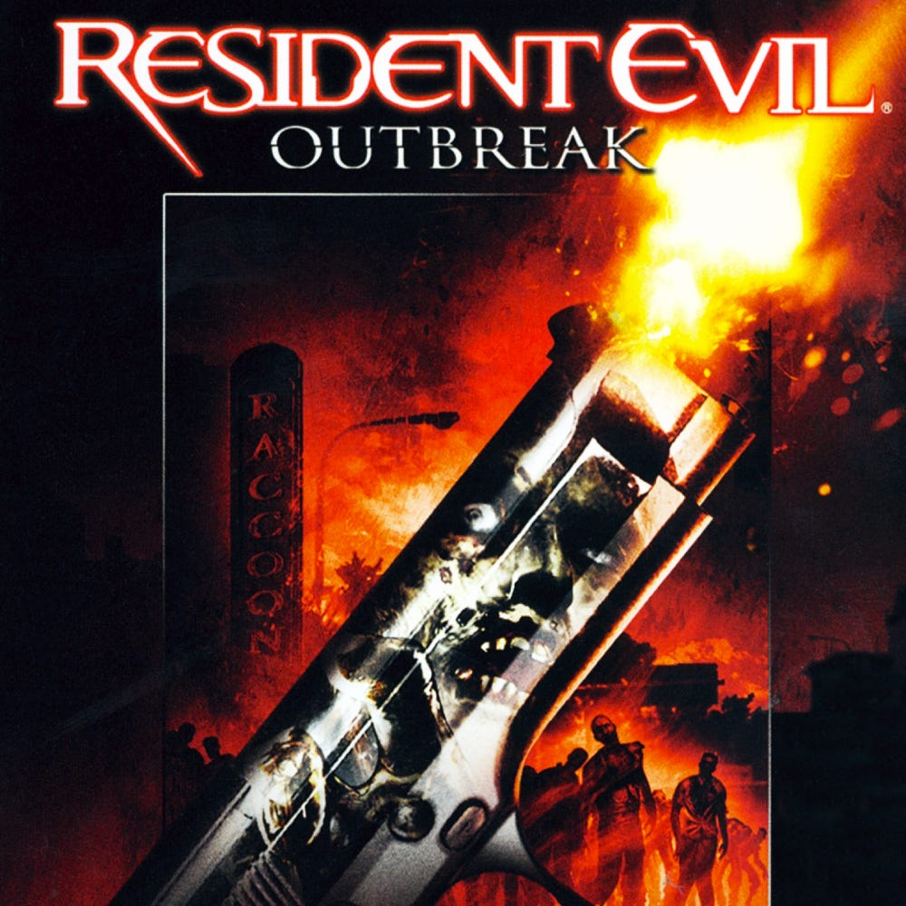
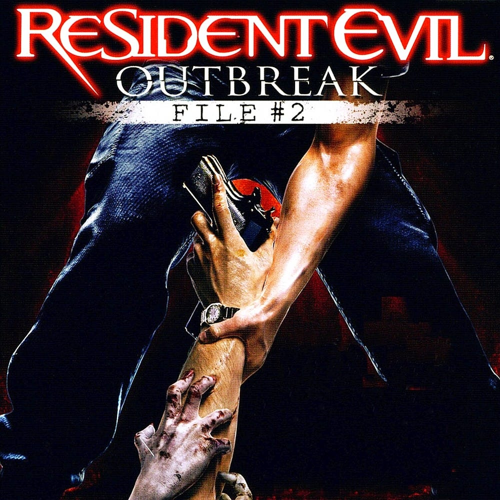

<h1 align="center">RE: Outbreak — macOS Native App Compiler</h1>

<p align="center">
  
  &nbsp;&nbsp;&nbsp;&nbsp;
  
</p>

<p align="center">
  <strong>Turn Resident Evil Outbreak PS2 ISOs into standalone native Apple Silicon macOS apps.</strong><br/>
  Pure static recompilation (ARM64 → Vulkan → MoltenVK → Metal) with automatic macOS Game Mode and zero emulator/Wine bloat.
</p>

<p align="center">
  
  
  <a href="LICENSE"></a>
</p>

---

* **No Windows launchers or .NET/Avalonia bloat**
* **No emulators or Wine/Rosetta**
* **Pure static recompilation:** Native ARM64 code → Vulkan compute → MoltenVK → Metal
* **macOS Game Mode enabled automatically**

---

## ✨ Features

- **One-Step Compiler:** Drag and drop your `.iso` into the script, and it outputs a double-clickable macOS `.app` bundle.
- **Auto-Detection:** Automatically identifies and verifies whether your disc is **File #1** or **File #2**.
- **Authentic Cover Art Icon:** Automatically fetches and formats the official high-resolution retail box cover into a crisp macOS `AppIcon.icns`.
- **Anti-Pixelation & 4K Supersampling:** Defaults to **4× internal resolution** (4K internal render) with hardware **SMAA** edge anti-aliasing and smooth bilinear filtering for crystal-clear visuals on Retina displays.
- **macOS Game Mode:** Launches in native macOS Fullscreen Space to automatically activate Apple's high-priority Game Mode on macOS 14+ (including macOS 27).
- **Self-Contained Bundle:** Generates a complete macOS app (`Resident Evil Outbreak.app` or `Resident Evil Outbreak - File #2.app`) with bundled shaders and MoltenVK.
- **Native Saves:** Game saves and memory cards are managed cleanly in `~/Library/Application Support/OutbreakRecomp/`.

---

## 💿 Supported Games

You must provide your own legally dumped disc image (BYOG model). The compiler verifies the executable's SHA-256 hash:

* **Resident Evil Outbreak (File #1):** NTSC-U v2.00 (`SLUS-20765`)
* **Resident Evil Outbreak File #2:** NTSC-U v1.05 (`SLUS-20984`)

*(PAL and Japanese versions are not supported by the underlying recompilation tables).*

---

## 🛠 Prerequisites

* **Hardware:** Any Apple Silicon Mac (M1/M2/M3/M4, macOS 12 Monterey or newer).
* **Xcode Command Line Tools:**
  ```zsh
  xcode-select --install
  ```
* **Required Build Tools (via Homebrew):**
  ```zsh
  brew install cmake ninja glslang spirv-tools molten-vk vulkan-headers
  ```
  *(Or pass `--install-deps` to the compiler script to let it install them for you).*

---

## 🚀 Quick Start

### Method 1: Run from Terminal

1. Open **Terminal** from Applications → Utilities.
2. Drag **`MakeOutbreakApp.command`** from Finder into the Terminal window.
3. Type a space, then drag your supported Outbreak `.iso` file into the window.
4. Press **Return** and keep Terminal open while the app is built.

This runs the command with the ISO path as its argument. Do not double-click the
`.command` file in Finder.

---

### Method 2: Terminal Command

```zsh
git clone https://github.com/passs0/reo.git
cd reo

# Basic build (creates a self-contained, 4K-supersampled .app)
./MakeOutbreakApp.command "/path/to/Resident Evil Outbreak.iso"
```

#### Custom Options:

```zsh
# Lower to 2x HD or 1x native 480p if needed on older hardware:
python3 make_mac_app.py "/path/to/game.iso" --resolution 2

# Use your own custom cover image for the app icon:
python3 make_mac_app.py "/path/to/game.iso" --cover "/path/to/my_art.jpg"

# Output the .app directly to your Applications or Desktop folder:
python3 make_mac_app.py "/path/to/game.iso" -o /Applications

# Symlink the ISO instead of copying it (saves ~2-4 GB disk space):
python3 make_mac_app.py "/path/to/game.iso" --link-iso
```

---

## 🎮 Complete Controls Guide

### Modern Controller Layout (Default for Gamepads)
Connected controllers (PS4, PS5, Xbox, Switch Pro) automatically use a **Modern Controls** preset (`REO_MODERN_CONTROLS=1`, similar to Resident Evil 2/4 Remake) so you don't have to use the clunky original PS2 triggers:

| Action | PlayStation Controller | Xbox Controller |
| :--- | :--- | :--- |
| **Aim Weapon** | **Hold `L2`** | **Hold `LT`** |
| **Shoot / Attack** | **Hold `L2` + Press `R2`** | **Hold `LT` + Press `RT`** |
| **Interact / Confirm / Open Doors** | **`Cross (✕)`** | **`A`** |
| **Cancel / Back / Quit Menu** | **`Circle (○)`** | **`B`** |
| **Inventory / Status** | **`Triangle (△)`** | **`Y`** |
| **Run / Sprint** | **Hold `Square (□)`** or **Click `L3`** | **Hold `X`** or **Click `LS`** |
| **Tackle / Special Ability** | **`R2`** *(when not aiming)* | **`RT`** *(when not aiming)* |
| **Switch Target** | **`L1` / `R1`** | **`LB` / `RB`** |

*(Prefer the original PS2 trigger layout? Pass `--classic-controls` when building or set `REO_MODERN_CONTROLS=0`.)*

### How to Run 🏃‍♂️
* **Keyboard:** Hold **`Q`** (Square) while moving with **`W`, `A`, `S`, `D`**.
* **Controller:** Hold **`Square (□)` / `X`**, or click **`L3` (Left Stick)** while moving.
* *Pro Tip:* Go to the in-game **Options → Control** menu and switch from **Type A** to **Type B**. In Type B, pushing the stick or movement key all the way forward runs automatically!

### Complete Keyboard Mapping

| Action | Mac Key | PS2 Equivalent |
| :--- | :--- | :--- |
| **Move / Walk** | `W` / `A` / `S` / `D` | Left Stick / D-Pad |
| **RUN** | **Hold `Q`** while moving | **Square (□)** |
| **Action / Confirm / Attack** | `Space` | **Cross (✕)** |
| **Aim Weapon / Ready Stance** | **Hold `2`** | **R1** |
| **Shoot / Swing Weapon** | Hold `2`, then press `Space` | R1 + Cross |
| **Cancel / Back out of menus** | `E` | **Circle (○)** |
| **Status Screen & Inventory** | `R` | **Triangle (△)** |
| **Tackle / Special Ability** | `4` | **R2** (e.g. Kevin kick, Cindy duck) |
| **Switch Target** | `1` / `3` | **L1** / **L2** |
| **Voice Callouts ("Help!", "Go!")** | **Arrow Keys** | Right Stick |
| **Pause Menu** | `Return` | **Start** |
| **Map / Select** | `Delete` / `Backspace` | **Select** |
| **Toggle Display Filter** | `F2` | Bilinear smoothing on/off |

*Connected gamepads (PS4, PS5, Xbox, Switch Pro) work automatically out-of-the-box via macOS GameController framework.*

---

## 📺 Visuals & Anti-Pixelation

The default settings are tuned specifically for Apple Silicon Retina screens:
* **Internal Resolution:** Defaults to **`4` (4× supersampling / 4K Ultra)**. You can change it to `2` (2× HD) or `1` (original 480p pixel look).
* **Anti-Aliasing:** Hardware SMAA (`REO_POST_AA=smaa`) smooths rough polygon edges without blurring HUD elements.
* **Display Filtering:** Smooth bilinear texture filtering is on by default. Press **`F2`** in-game at any time to toggle between smooth filtering and raw pixels.

---

## 🏆 Apple Game Mode

macOS 14 and newer (including macOS 27) automatically turn on **Game Mode** when the game starts in native fullscreen:
* Gives Outbreak top GPU and CPU scheduling priority.
* Drastically reduces latency for Bluetooth controllers (AirPods, DualSense, Xbox).
* Look for the **Game Mode** badge in the macOS menu bar.

---

## 📁 Saves & Memory Cards

Memory cards are stored in your user directory:
```
~/Library/Application Support/OutbreakRecomp/memory-cards/default/data
```
Deleting or updating your `.app` will never erase your saved games.

---

## 🔄 Updating

When new updates are released to the compiler script or the underlying engine:

1. **Pull the latest changes:**
   ```zsh
   cd /path/to/reo
   git pull origin main
   ```
   *(If you also want to pull changes from the original upstream project `Ninjacornix/reo`, run `git fetch upstream && git merge upstream/main`.)*

2. **Rebuild the `.app`:**
   ```zsh
   ./MakeOutbreakApp.command "/path/to/Resident Evil Outbreak.iso"
   ```
   * **Incremental & Fast:** The script reuses your cached `build-macos/` files. If only packaging scripts or settings changed, it finishes in **~10–30 seconds**. If C++ engine code changed, Ninja only recompiles the modified files.
   * **Saves are Safe:** Your memory cards in `~/Library/Application Support/OutbreakRecomp/` are untouched.
   * If you previously moved the `.app` to `/Applications`, simply replace it with the newly generated one (or pass `-o /Applications` when running `make_mac_app.py`).

---

## ⚖️ Legal & Disclaimer

This is an unofficial, open-source fan project. **No copyrighted game files, ISOs, or proprietary assets are included in this repository.** Users must provide their own legally acquired disc image to compile the game.

## 🤝 Credits & Upstream

* Upstream project: [Ninjacornix/reo](https://github.com/Ninjacornix/reo)
* Static Recompilation: [PS2Recomp](https://github.com/sp00nznet/PS2Recomp)
* GPU Emulation: [paraLLEl-GS](https://github.com/Arntzen-Software/parallel-gs) & [Granite](https://github.com/Themaister/Granite)
* Metal Translation: [MoltenVK](https://github.com/KhronosGroup/MoltenVK)
